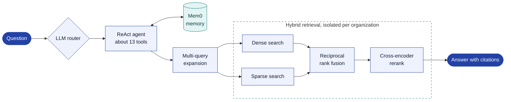

<picture>
  <source media="(prefers-color-scheme: dark)" srcset="assets/hero-dark.svg">
  
</picture>

  
  
  

I'm a software engineer who specializes in LLM-based systems. For three years I've taken retrieval-augmented generation, agents and LLM evaluation from prototype to production. I started on post-training data and RLHF-style evaluation at Turing, and I'm now lead engineer on **Arq**, an AI security and compliance platform.

## Ask Arq, the system I lead

Arq is an AI-powered security and compliance platform for SOC 2, ISO 27001 and HIPAA. I own its backend, frontend, AI pipeline and deployment. Ask Arq is the assistant inside it: an agentic RAG system built on LangGraph that answers with citations.

Around it I also built:

- a questionnaire and RFP agent that flags low-confidence answers and writes reviewer corrections back to the knowledge base
- an LLM contradiction detector for policy documents
- an integration agent that takes actions in connected apps through MCP
- threat-intelligence ingestion that matches CVEs to customer findings
- cloud, code and external security scanning with GRC control mapping, plus the Slack bot, Chrome extension and mobile app

## Career

<picture>
  <source media="(prefers-color-scheme: dark)" srcset="assets/timeline-dark.svg">
  
</picture>

Select a role to see the details.

<b>Arq Tech</b>: lead software engineer, US (remote). <i>Dec 2025 to now</i>

 

- Lead engineer on Arq, an AI security and compliance platform (SOC 2, ISO 27001, HIPAA). I own the backend, frontend, AI pipeline and deployment.
- Built Ask Arq, the agentic RAG assistant [described above](#ask-arq-the-system-i-lead): an LLM router, a ReAct agent over about 13 tools, Mem0 memory, hybrid dense and sparse retrieval with reciprocal rank fusion, multi-query expansion, cross-encoder reranking and per-organization isolation.
- Built the questionnaire and RFP agent, the policy contradiction detector, the MCP integration agent and CVE threat-intelligence matching.
- Led delivery of security scanning and GRC control mapping. Shipped the Slack bot, Chrome extension and mobile app.

<b>INOVAQO</b>: software engineer. <i>Dec 2024 to Nov 2025</i>

 

- Led end-to-end development of several generative AI projects, connecting LLM-powered features to APIs, databases and third-party platforms to automate business workflows.
- Designed scalable architectures with cross-functional teams and tuned them for performance.
- Built the project-management modules and a Slack bot for the company HRMS, cutting response times by 35%.

<b>Ginkgo Retail</b>: software engineer. <i>Jun 2024 to Nov 2024</i>

 

- Rebuilt the backend of Comverse, a Shopify-alternative enterprise e-commerce platform. Multithreading, asynchronous processing and batch operations made its APIs 30% faster.
- Integrated Dengage for Bareeze to automate customer engagement.

<b>FAST-NU</b>: teaching assistant, Programming Fundamentals and Software Engineering. <i>Jul 2023 to Nov 2023</i>

 

- Ran lab sessions, mentored students in software design, graded work, reviewed code and helped with debugging.

<b>Turing</b>: software engineer, AI/ML (remote). <i>Jan 2023 to Jun 2023</i>

 

- Produced annotated datasets for LLM post-training covering code understanding, reasoning and instruction following, across text and code.
- Ran RLHF-style evaluations, rating and ranking model responses for correctness, helpfulness and safety, and refined the datasets over iterative training cycles based on model performance.
- Worked with researchers at leading US AI labs to refine annotation standards, and automated data-quality checks in Python that flagged labeling inconsistencies at high volume.

## Projects

| Project | What it does | Built with |
| :-- | :-- | :-- |
| **[Droid Shuttle](https://github.com/ammarmunir4567/droid-shuttle)** open source | Manages an Android phone from a Mac over USB, with nothing to install on the phone. It has a custom ADB client in Rust for instant hot-plug detection, resumable SHA-256-verified transfers that survive a pulled cable, incremental AES-256 backups, a duplicate finder that hashes on the device, and scrcpy screen mirroring. [Download for Mac](https://github.com/ammarmunir4567/droid-shuttle/releases/latest) | Rust, Tauri 2, React, TypeScript |
| **[Env Scanner](https://github.com/ammarmunir4567/env-scanner)** on PyPI | Finds the configuration a codebase depends on without running it, then writes `.env.example`. It parses Python with the AST, pattern-matches YAML, JSON, TOML and INI, and knows the conventions of Django, Flask, FastAPI and Pydantic. Install with [`pip install env-scanner`](https://pypi.org/project/env-scanner/). | Python, AST, Click, Pytest |
| **Joint Logic** private | Keeps rehab patients engaged between clinic visits. LLM agents with retrieval send reminders and personalized recovery insights over WhatsApp. Clinicians get a dashboard with patient analytics, alerts and a human-in-the-loop path for critical messages. | LangChain, FastAPI, Pinecone, Twilio, Next.js |
| **Review Munch** private | Pulls structured insight out of noisy restaurant reviews on JavaScript-rendered pages: Selenium extraction, review classification, sentiment analysis and embedding-based semantic search, behind a chat interface with dashboards. | FastAPI, Pinecone, Selenium, Next.js, MySQL |
| **[Quiz Generator](https://github.com/ammarmunir4567/MCQS_Generator)** [frontend](https://github.com/ammarmunir4567/MCQS_Generator_Frontend) | Generates AI quizzes for any job role, with instant scoring and feedback. | React, LangChain, LLaMA 3 |
| **HRMS at INOVAQO** private | Project-management modules and a Slack bot for vacation notifications; performance work cut response times by 35%. | Django, PostgreSQL, Celery, Slack API, Docker |

## Toolbox

| | |
| :-- | :-- |
| **Agents and retrieval** | LangGraph, LangChain, LlamaIndex, Mem0, MCP, RAG, hybrid search, reranking, prompt and context engineering, NLP |
| **Models** | OpenAI, LLaMA, Whisper, Hugging Face |
| **Languages** | Python, TypeScript, JavaScript, Rust, C++ |
| **Backend** | FastAPI, Django, Flask, Celery, RabbitMQ |
| **Frontend and desktop** | React, Next.js, Tauri |
| **Data** | PostgreSQL, MongoDB, MySQL, Redis, Pinecone |
| **Cloud and tooling** | AWS (EC2, ECS, RDS, S3), Terraform, Docker, CI/CD, Pytest, Selenium |

## Research interests

Large language models and generative AI, retrieval-augmented generation and semantic search, LLM evaluation and the quality of human-feedback data, LLM-based agents, and AI-assisted software engineering. My post-training and RLHF evaluation work is why I care about how reliable generative models are and how we measure that. I'm looking to take this into graduate research on retrieval-augmented and agentic systems.

## Education and honors

- **BS Computer Science**, National University of Computer and Emerging Sciences (FAST-NU), Lahore, 2020 to 2024
- **Dean's List**, FAST-NU Lahore, Spring 2023 and Fall 2024
- **Bug Catcher competition**, NASCON '23, FAST-NU Islamabad
- **English** C1 (IELTS band 7), **Urdu** native

 

<picture>
  <source media="(prefers-color-scheme: dark)" srcset="assets/band-dark.svg">
  
</picture>

Away from the keyboard I paint and sketch (<a href="https://www.instagram.com/art_of_ammar/">@art_of_ammar</a>), play football and play video games.
