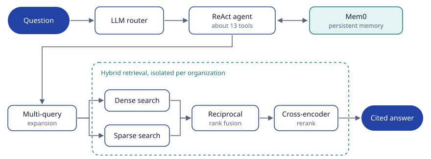

<picture>
  <source media="(prefers-color-scheme: dark)" srcset="assets/hero-dark.svg">
  
</picture>

  
  
  

I'm a software engineer who specializes in LLM-based systems. For three years I've taken retrieval-augmented generation, agents and LLM evaluation from prototype to production. I started on post-training data and RLHF-style evaluation at Turing, and I'm now lead engineer on **Arq**, an AI security and compliance platform.

## Ask Arq, the system I lead

Arq is an AI-powered security and compliance platform for SOC 2, ISO 27001 and HIPAA. I own its backend, frontend, AI pipeline and deployment. Ask Arq is the assistant inside it: an agentic RAG system built on LangGraph that answers with citations.

<picture>
  <source media="(prefers-color-scheme: dark)" srcset="assets/ask-arq-dark.svg">
  
</picture>

Around it I also built:

- a questionnaire and RFP agent that flags low-confidence answers and writes reviewer corrections back to the knowledge base
- an LLM contradiction detector for policy documents
- an integration agent that takes actions in connected apps through MCP
- threat-intelligence ingestion that matches CVEs to customer findings
- cloud, code and external security scanning with GRC control mapping, plus the Slack bot, Chrome extension and mobile app

## Toolbox

| | |
| :-- | :-- |
| **Agents and retrieval** | LangGraph, LangChain, LlamaIndex, Mem0, MCP, RAG, hybrid search, reranking, prompt and context engineering, NLP |
| **Models** | OpenAI, LLaMA, Whisper, Hugging Face |
| **Languages** | Python, TypeScript, JavaScript, Rust, C++ |
| **Backend** | FastAPI, Django, Flask, Celery, RabbitMQ |
| **Frontend and desktop** | React, Next.js, Tauri |
| **Data** | PostgreSQL, MongoDB, MySQL, Redis, Pinecone |
| **Cloud and tooling** | AWS (EC2, ECS, RDS, S3), Terraform, Docker, CI/CD, Pytest, Selenium |

 

<picture>
  <source media="(prefers-color-scheme: dark)" srcset="assets/band-dark.svg">
  
</picture>

Away from the keyboard I paint and sketch (<a href="https://www.instagram.com/art_of_ammar/">@art_of_ammar</a>), play football and play video games.
